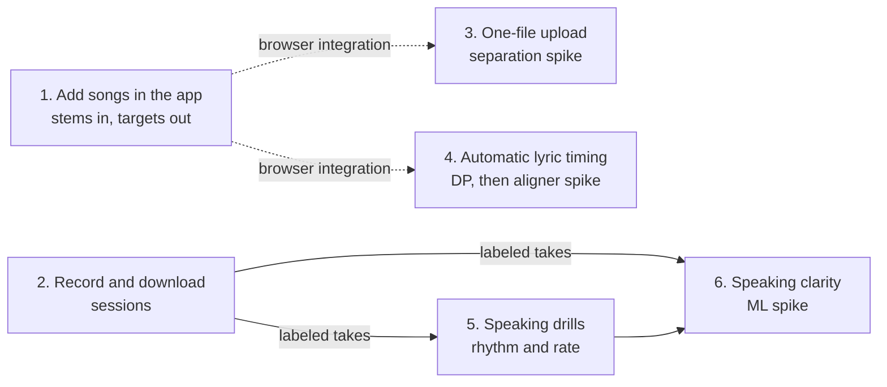

# Pitch Hero vision roadmap

Status **accepted**, decisions D1 to D5 resolved, Phase 1 in progress · Date 2026-11-18 ·
Baseline `make check` green (typecheck clean, 126 tests pass, 1 skipped)

## The vision

> Upload new songs + lyrics and get singing targets generated automatically.
> Way later = Auto timing generation for uploaded songs/lyrics. From there = would like to expand
> to speaking voice exercises in the future.. like Tongue twisters / gamified articulation and
> clarity interactions… And finally, a downloadable recording option for singing/speaking
> practice sessions.

## Short answer

| Vision item | Where it stands | Kind of work left | Phase |
| --- | --- | --- | --- |
| Upload songs, targets generated | Analysis core exists and is tested, but only as a Python command on a dev machine; needs an isolated vocal stem; the app cannot register a new song | Engineering (port + UI); research only if a single full mix must be accepted | 1, 3 |
| Automatic lyric timing | Not started beyond tap-sync with onset snapping; phrase pre-fill exists but applies to neither committed song | Research spike with a numeric gate, then integration | 4 |
| Speaking exercises | Not started; mic, onset detection and click scheduling are reusable | Engineering for rhythm and rate; research for clarity | 5, 6 |
| Downloadable recordings | Not started; every building block exists | Engineering only | 2 |

One item is engineering on existing parts, one is half built, and two are research problems
whose accuracy on this project's material is unknown. Each research phase therefore starts with
a spike that answers one question with a number and is allowed to fail.

TonalEnergy is a useful model for the product design of recording review and metronome drills
(Phases 2 and 5). It does none of the hard parts (separating a song, aligning lyrics, scoring
articulation), so it does not reduce the research risk. See
[Using TonalEnergy as a model](#using-tonalenergy-as-a-model).

## Where the code stands

**Song ingestion.** `tools/prepare_song.py` and `tools/vocal_targets.py` align the stems by
cross-correlation, track the isolated vocal with pYIN, turn the contour into stable notes
(vibrato, scoops, octave blips, dropouts, outliers) and report what was left out and why. The
app reads songs as data (`public/songs/index.json`, `song.json`, `melody.json`, `timing.json`)
and stores picked audio in IndexedDB (`src/core/songpack.ts`). Gaps:

- the registry is a static file, so the deployed app cannot add a song;
- analysis needs Python, numpy, scipy and librosa on a dev machine;
- the input must include an isolated vocal; the one song without it (Old Town Road) needed the
  567-line subtraction extractor (`tools/extract_melody.py`) and a diagnostics record.

**Lyric timing.** `src/ui/screens/sync.ts` plays the reference, snaps taps to vocal onsets and
offers *Pre-fill from vocal phrases* only when the phrase count equals the line count. Neither
committed song qualifies: Love Yourself has 31 phrases for 48 lines, Old Town Road 21 for 46.
`docs/SONG_PACK.md` already specifies the automated format (`tools/align_lyrics.py`, provenance
field, words only where every word clears the aligner's confidence).

**Speaking.** Nothing speech-specific exists. Reusable parts are the mic path
(`src/audio/mic.ts`), `OnsetDetector` and `estimateLatency` (`src/audio/onset.ts`), and the
click scheduling in latency calibration (`src/ui/screens/latency.ts`), which already asks the
user to *say a short "ta" right on the click*.

**Recording.** Nothing records today. Mic audio already arrives as 512-sample chunks stamped
with AudioContext time; the song clock and the calibrated latency map those stamps to song time
(`src/ui/screens/sing.ts`, `onFrame`); IndexedDB storage exists (`src/core/idb.ts`).

**Tempo and key are not on the critical path.** `ScoreEngine` converts its boundary tolerance
and frame times through the same seconds-per-beat (`src/core/scoring.ts`), so Sing scores do
not depend on `bpm`, and `parseMelody` defaults `bpm` to 120. A wrong tempo misplaces highway
bar lines, changes scroll density and resizes the 0.3-beat nearest-note window that colors the
trail in `sing.ts`; the key only chooses sharps or flats on the results screen. This keeps the
browser port in Phase 1 small.

## Principles carried forward

1. **Local-first.** Song audio and microphone audio stay in the browser unless the user opts
   into a server step ([D2](#open-decisions)).
2. **No copyrighted audio or lyrics in git.** Only derived data is committed
   (`docs/SONG_PACK.md`, *What is committed*).
3. **Python stays the reference implementation.** Every browser port is tested against
   fixtures the Python tools produce.
4. **Provenance on every generated artifact** (tool, tracker, parameters, versions). The
   unrecoverable 175-note run in `docs/diagnostics/2026-11-10-recorded-run.md` is the
   precedent.
5. **Research phases start with a spike** that has a numeric gate and a kill criterion, run in
   Python where iteration is fastest. Nothing is ported until its gate passes.

## Phases

Solid arrows are hard dependencies. Dashed arrows mean the spike can run on its own, but
shipping it inside the app needs Phase 1. Phase 2 is independent of Phase 1 and is the
smallest phase; it comes early because its recordings are the test corpus for Phases 5 and 6.

### Phase 1. Add a song in the app from stems

**Status (2026-11-18): built; the real-song gate is still open.** What was verified:

- Note logic: identical notes, timing and loss accounting to `tools/vocal_targets.py` on 13
  fixture contours, three of them 25 s randomized realistic contours.
- pYIN: the same voicing and the same pitch bin as librosa 1.0.1 on every frame of the
  synthetic vocal fixture, voicing probability within 1e-4.
- Whole pipeline in Chromium on the production build: on a synthetic 44 s song decoded by the
  browser, the saved `melody.json` matched `prepare_song.py`'s in every field except
  `source.tool`, tempo and key (simplified by design). Add, save, reload, practice playback,
  package download, analyze again and delete all worked, with no page errors.
- iPhone (D5): the home screen at iPhone size matches `main` apart from the new button.
- Speed: a four-minute song takes about 21 s in Node on the build container (alignment 8 s,
  pitch tracking 10 s, tempo 2 s).

Open: the real-song parity gate needs the audio, which is not in the repository. Run
`make parity SONG=love-yourself` on the machine that has the stems. The opt-in
`referenceVocal` check on a browser-made melody is also not yet run.

**Goal.** On the deployed site, with no dev machine, the user drops an instrumental, an
isolated vocal, an optional full mix and lyrics; the browser computes the targets; the song
appears in the picker and works like a committed song (Sing, Practice, Sync, results).

**Approach.**

1. Decode on the main thread with an `OfflineAudioContext` at 22,050 Hz mono (Web Audio's
   decoder is not available in workers), then transfer the samples to a module Web Worker. Use the
   Python tools' frame grid (FFT 2048, hop 256, 65 to 1100 Hz) so the note logic sees the
   same input.
2. Port to TypeScript in a new `src/analysis/`:
   - `vocalTargets.ts` from `tools/vocal_targets.py`: pure numeric code (gap bridging, octave
     repair, segmentation on a vibrato-smoothed contour, outlier removal, loss accounting);
   - `pyin.ts`, pYIN with librosa's parameters. The note thresholds were tuned on pYIN
     contours, so the app's real-time MPM tracker is only a fallback if the port misses its
     gate. librosa's Viterbi runs over roughly 980 states per frame; the port must use the
     transition matrix's band structure to stay fast;
   - `align.ts` from `measure_lag` (windowed FFT cross-correlation), reusing
     `src/audio/pitch/fft.ts`, needed only when a full mix is supplied;
   - `prepare.ts` from `analyze()`, writing the existing `melody.json` schema with
     `source.tool: "browser"` and the same `analysis` block.
3. Tempo is a simple onset-autocorrelation estimate, or bar lines are hidden for browser-made
   songs. Port `beat_track` and key estimation only if bar lines prove worth it.
4. Local song registry. The definition is stored under a new IndexedDB key `<id>/song`; the
   existing `<id>/<file>` keys stay unchanged (`songpack.ts` says that format must not
   change). The vocal stem is stored too (`<id>/vocal`), because it is the input to
   re-analysis and to Phase 4. `loadRegistry` merges static and local songs and rejects a
   local id that collides with a static one. Call `navigator.storage.persist()`.
5. UI. An *Add song* screen: drop zone sorted by the existing `audioRole` rules, title and
   artist, lyrics paste or file, progress with cancel, and the report `prepare-song` prints
   (scored seconds, seconds left out by reason, range, the *wrong file* warnings). The home
   picker becomes a list. Settings gains *Re-analyze* and *Delete song*.
6. Export. *Download song package* writes `song.json`, `melody.json` and `timing.json`, so a
   browser-made song can be committed and appear on every device. The commit-derived-data
   workflow stays intact.

**Acceptance criteria** (values proposed; confirm before building)

- Fixture parity: JSON fixtures produced by the Python reference (contours in, notes out;
  deterministic synthetic audio in, f0 out) match the TypeScript output with identical note
  MIDI values, note boundaries within 2 frames, f0 within 10 cents where both are voiced and
  voicing agreement of at least 98 %.
- Real-song parity, as an opt-in test that reads local stems like `referenceVocal`: on Love
  Yourself, browser targets cover at least 95 % of the committed Python target seconds at the
  same MIDI note, and the note count is within 5 %.
- The existing `referenceVocal` gate (singing exactly like the reference scores at least 75 %)
  passes on the browser-made melody.
- On the Pages site, a song added from stems survives a reload, can be synced and completes a
  scored Sing run.
- All existing tests pass and the committed songs load unchanged.

**Risks.** pYIN port fidelity (gated by the fixtures); a wrong file in a slot, such as a full
mix in the vocal slot (caught by the ported report warnings); browser and librosa MP3 decoders
can disagree by a few tens of milliseconds of encoder delay, which shifts targets slightly
against Python's but consistently with the browser's own playback. Memory is modest: three
decoded four-minute tracks at 22,050 Hz are about 64 MB of float32. Phone compute is out of
scope per D5.

### Phase 2. Record and download sessions

**Goal.** Any session (Sing, Practice, Pitch Monitor, later the speaking drills) can be
recorded, replayed with its pitch trail and downloaded. Nothing leaves the device unless the
user downloads or shares it.

**Approach.**

1. Capture both sides in AudioContext time. The mic chunks are already stamped. Add a second
   tap with the same worklet on the `TrackPlayer` master bus, so the recording holds exactly
   what was heard, including slowed speed, A–B loops, pauses and the reference-vocal toggle.
   Rebuilding the mix offline from the instrumental file would fail for slowed practice,
   because the browser's pitch-preserving stretch cannot be reproduced offline.
2. Align with the scorer's own mapping. The scorer places a frame stamped `t` at
   `songTimeAt(t - latency)`; the mixdown shifts the mic against the playback tap by the same
   calibrated round-trip latency. A take that sounds aligned is aligned the way it was scored.
3. Store 16-bit PCM, the voice frames (time, pitch, voiced) and session metadata in IndexedDB,
   flushing chunks during long sessions instead of holding them in memory. The frames let the
   Recordings screen replay the trail over the target highway, which TonalEnergy cannot do
   because it has no targets.
4. Export WAV first (no dependency; plays everywhere): vocal only, and the mix. Mono 16-bit at
   48 kHz is about 5.8 MB per minute per track. Compressed export through WebCodecs or
   MediaRecorder is a follow-up because browser support differs ([D4](#open-decisions)).
5. UI. A record toggle on the session HUD, off by default, with a visible indicator. A
   Recordings screen lists takes (song or exercise, mode, speed, score, size, date) with play,
   rename, delete and download; Web Share as the fallback where `<a download>` misbehaves.

**Acceptance criteria**

- Unit test: synthetic mic and playback chunks with a known latency mix so that an impulse
  lands within 1 ms of its expected position.
- Clap test: with calibrated latency, claps on the beat in Sing mode line up with the
  instrumental's beat within 20 ms in the downloaded mix (checked on the waveform).
- A 50 % practice take with an A–B loop plays back as it was heard.
- Download verified in current Chrome, Firefox and Safari on desktop, and Safari on iPhone if
  it is a target ([D5](#open-decisions)).
- The home screen's privacy line stays true.

**Risks.** Safari can evict script-written storage for sites left unvisited, so the download is
the durable copy. iOS download behavior needs a device check.

### Phase 3. One-file upload (source separation)

Deferred per D1: songs arrive as separate files.

**Question.** Do vocals separated by a current open model produce targets as good as the
stems used for Love Yourself?

**Spike.** On a dev machine, run `demucs --two-stems=vocals` on the Love Yourself full mix,
then `prepare-song` on the separated vocal and instrumental in a scratch folder. Compare with
the committed `melody.json` using Phase 1's real-song parity metric, run the `referenceVocal`
gate on the separated vocal, and listen to the separated instrumental for vocal bleed, since
it becomes the karaoke track. Record command, versions and output hash under
`docs/diagnostics/`.

**Kill criterion.** If separated vocals miss the parity gate, stems stay the required input and
the docs say where to get them.

**Runtime, chosen only after the gate passes.**

- (a) `prepare-song --separate` on a dev machine. Cheapest.
- (b) In the browser with ONNX Runtime Web or WebGPU builds of HTDemucs (several public ports
  exist). Keeps local-first; costs a large model download, minutes of compute and segmenting
  to stay under WebAssembly's 4 GB memory limit.
- (c) A hosted GPU endpoint. Uploads copyrighted audio to a server and breaks the local-first
  promise; only with [D2](#open-decisions).

Run the spike with (a); choose (b) if the in-app flow must accept a single file. Check the
model weights' license before bundling them.

**Not recommended.** Generalizing the instrumental-plus-mix subtraction used for Old Town Road.
It yields targets for 43.3 s of 91.7 s of detected vocal (47 %); the isolated-stem path yields
141.9 s of 204.7 s (69 %) for Love Yourself. The songs differ (Old Town Road has rapped and
spoken passages), so this is not a controlled comparison, but nothing in the record argues for
extending subtraction.

### Phase 4. Automatic lyric timing

**4a, no ML: line-to-phrase alignment when counts differ.** A dynamic-programming alignment
assigns contiguous lyric lines to vocal phrases, splitting phrases at internal note gaps and
weighting estimated syllables per line against notes per phrase. It pre-fills both committed
songs, which today's equal-count rule cannot. Ground truth is the two hand-synced `timing.json`
files; their own precision is limited by tap-sync, so they bound how strict a gate can be.
Gate: median line-start error at most 0.3 s and at least 85 % of lines within 0.5 s on both
songs.

**4b, spike: forced alignment on the isolated vocal.** `tools/align_lyrics.py` as already
specified in `docs/SONG_PACK.md`. Candidates: stable-ts, WhisperX and torchaudio's MMS
aligner. torchaudio 2.8 marked its alignment API for removal and the maintainers later said
`forced_align` would be kept, so pin the version used. Same ground truth, stricter gate: median
at most 0.2 s, at least 90 % within 0.5 s, no out-of-order lines. Kill criterion: if no
candidate beats 4a on both songs, ship 4a with the Sync tool as the review step.

**4c, integration.** Per D3 the first integration is the dev-machine command; the in-app flow
uses 4a and accepts an imported `timing.json`. A browser aligner (Whisper through transformers.js) is a
later candidate; its word-timestamp support on WebGPU has had open issues, so re-verify it then.

### Phase 5. Speaking drills: rhythm and rate

**Goal.** A first speaking mode that scores only what the current audio stack measures
reliably: timing against a beat, speaking rate and steadiness. No clarity score.

**Scope.**

1. Exercise packs as data, like song packs: `public/exercises/<id>.json` with text, syllable
   split, tempo ladder, repetitions and drill type. Many traditional tongue twisters are public
   domain and can be committed, unlike song lyrics; record each one's source.
2. Drills. (a) Syllables on the beat (pa-ta-ka style, one per click or subdivision): per-syllable
   offset after latency compensation, scored by `OnsetDetector` and an `estimateLatency`-style
   matcher; the tempo ladder advances when a set share lands inside a window. (b) Tongue-twister
   pacing: repeat a line N times after a count-in; measure syllable rate, pauses and
   repeat-to-repeat consistency from the energy envelope.
3. A metronome with count-in and subdivisions, scheduled in AudioContext time (`playDrum`
   already does this for calibration). TonalEnergy's metronome is the UX reference.
4. Results and history per exercise; drills can be recorded with Phase 2.

**Gate.** Hand-label syllable onsets in Phase 2 takes at rising rates. Onset detection must
reach precision and recall of at least 0.9; the highest rate that passes, found by
measurement, caps the tempo ladder, and nothing above it is scored.

### Phase 6. Speaking clarity scoring

**Problem.** Clarity needs a model of speech content. Recognizers with a strong language model
tend to output the expected sentence even when it was slurred, which inflates a tongue-twister
score. That bias is the central risk.

**Candidates.**

- (a) A phoneme-level CTC recognizer without a language model, run locally (ONNX in the
  browser, or a CLI for the spike), scored as phoneme error rate against the reference text's
  phonemes.
- (b) Whisper-family word recognition scored as word error rate. Cheapest to try and most
  exposed to the bias above.
- (c) Azure Pronunciation Assessment, which returns accuracy, fluency, completeness and prosody
  against a reference text. Cloud, per-use cost, audio leaves the device
  ([D2](#open-decisions)), and at least one user has reported near-perfect scores for poor
  pronunciation.

**Corpus.** Phase 2 takes of the same speaker reading each twister clearly and deliberately
slurred, at several tempos, labeled.

**Gate.** On held-out takes, a candidate ranks the clear take above the slurred take of the same
twister in at least 90 % of pairs. Kill criterion: if none passes, the speaking mode keeps
rhythm and rate only.

## Using TonalEnergy as a model

**What it is.** A tuner and metronome for instrumentalists with a tone generator, analysis
views and a recorder. Public descriptions list an analysis page (waveform and pitch, spectral
and harmonic views, a pitch-over-time plot for steadiness); a recording suite (record, play
back, rename, delete, share) with analysis views during playback, tempo and pitch adjustment
of recordings and export through share targets; a metronome with meters, subdivisions and
visual displays; and a tone generator on every page. The Mac bundle ships content as versioned
packs (`Click_v010.zip`, `TEAInstruments_v008.zip`, `docs_v012.zip`) beside data files
(`StringTunings.json`, `master_scales.sxml`) and fonts. The bundle itself was not inspected;
see the note at the end of this section.

**Where it is a useful model.**

| TonalEnergy | Use in Pitch Hero | Phase |
| --- | --- | --- |
| Recording suite with analysis during playback, export | Recordings screen; replay the voice trail over the target melody, which TonalEnergy lacks | 2 |
| Metronome meters, subdivisions, visual displays | Count-in, subdivision clicks and tempo ladder for diction drills | 5 |
| Pitch-over-time steadiness plot | Already covered by Pitch Monitor and results; optional intonation-range view for speech | 5 |
| Versioned content packs, data not code | Exercise packs alongside song packs | 5 |
| Tone generator | Not in the vision | none |

**Where it is not.** It has no songs, lyrics, separation, target extraction or speech scoring.
Those are the parts with real technical unknowns (Phases 3, 4 and 6), so TonalEnergy shortens
design work on Phases 2 and 5 and does not shorten the research.

**Using it without creating problems.**

- Read its manual (`docs_v012.zip`) outside this repository and keep screenshots of flows as
  design references.
- Do not copy its samples, click sounds, fonts, manual text or visual identity into this
  repository; the repository and the Pages site are public.
- Do not decompile the binary. App licenses typically prohibit it, and it would yield nothing
  new: pitch detection and sample-accurate click scheduling already exist and are tested here.

The bundle could not be opened from the cloud session that wrote this plan (the Mac's shared
folders were not available to it, and `/Applications` was not shared). Unzipping the manual
locally and sharing its table of contents would let a later session map specific screens.

## How this plan avoids spinning wheels

1. **Measure against ground truth already in the repo.** The committed Python `melody.json`
   files are the port oracle, the hand-synced `timing.json` files are the alignment oracle, and
   `referenceVocal` is the target sanity check.
2. **Spike, gate, then port.** Research runs in Python on a dev machine; the browser gets only
   what passed.
3. **Clean inputs over heroic signal processing.** Stems (or separation) instead of
   subtraction, per the Phase 3 evidence.
4. **Keep every spike's provenance** (command, versions, output hash) under
   `docs/diagnostics/`, so a result can be reproduced or retired.
5. **TonalEnergy is a product reference**, not a source of algorithms or assets.

## Open decisions

Resolved 2026-11-18. Each answer follows its question.

- **D1. Song source.** Do you usually have an instrumental and an isolated vocal, or only the
  full song? *Separate files.* Phase 3 is deferred until a song arrives without stems.
- **D2. Server processing.** May audio ever leave the browser (separation, alignment,
  pronunciation scoring)? *Yes, when that is the better workflow.* Options 3(c) and 6(c)
  stay open; the home-screen promise about the microphone must change in the same release
  that sends any audio off the device.
- **D3. Where automatic timing runs.** Is a dev-machine command acceptable, or must it run in
  the app? *A command on the dev machine is fine, especially for the initial integration.*
  Phase 4 ships as `tools/align_lyrics.py` first.
- **D4. Recording format.** Is WAV acceptable for the first version, given its size? *Yes.*
- **D5. Devices.** Is Safari on iPhone a target? *Adding songs and generating targets may be
  desktop-only at first. Every committed song in `public/songs/` and all singing feedback must
  work on iPhone.* Phase 1's Add Song flow is therefore verified on desktop browsers only, and
  every phase must not regress the existing sing, practice and results screens on iPhone.
  Verifying those screens on a real iPhone is its own work item, because it cannot be done
  from a Linux container.

## Non-goals

Accounts and cross-device sync (browser-made songs reach other devices by committing their
derived JSON); hosting copyrighted audio or lyrics; scoring rapped or spoken passages inside
songs; multiplayer.

## References

Internal: `docs/SONG_PACK.md`, `docs/superpowers/specs/2026-11-08-pitch-hero-design.md`,
`docs/diagnostics/2026-11-10-recorded-run.md`, `tools/prepare_song.py`,
`tools/vocal_targets.py`, `tools/extract_melody.py`, `src/core/songpack.ts`,
`src/core/songs.ts`, `src/core/melody.ts`, `src/core/scoring.ts`, `src/audio/mic.ts`,
`src/audio/onset.ts`, `src/audio/trackPlayer.ts`, `src/ui/screens/sing.ts`,
`src/ui/screens/sync.ts`, `src/ui/screens/latency.ts`.

External:

- [TonalEnergy](https://tonalenergy.com/) and its [App Store listing](https://apps.apple.com/us/app/tonalenergy-tuner-metronome/id497716362)
- [Colin Dorman, app review: TonalEnergy](https://colindorman.com/horn/app-review-tonalenergy/)
- [free-music-demixer (demucs.cpp, browser Demucs)](https://www.github.com/sevagh/free-music-demixer), [demucs-rs](https://github.com/nikhilunni/demucs-rs), [htdemucs ONNX for the web](https://huggingface.co/monteslu/htdemucs-web-onnx), [Open-Unmix in WebAssembly, memory limit](https://sevagh-github-io.pages.dev/blog/umxcpp)
- [torchaudio CTC forced alignment tutorial, 2.8 deprecation note](https://docs.pytorch.org/audio/2.8/tutorials/ctc_forced_alignment_api_tutorial.html), [pytorch/audio#3902](https://github.com/pytorch/audio/issues/3902)
- [transformers.js#820, word timestamps on WebGPU](https://github.com/huggingface/transformers.js/issues/820)
- [Azure pronunciation assessment](https://learn.microsoft.com/fi-fi/azure/ai-services/speech-service/language-learning-with-pronunciation-assessment), [reported inflated scores](https://learn.microsoft.com/en-us/answers/questions/1680083/cognitive-services-pronunciation-assessment-always)
