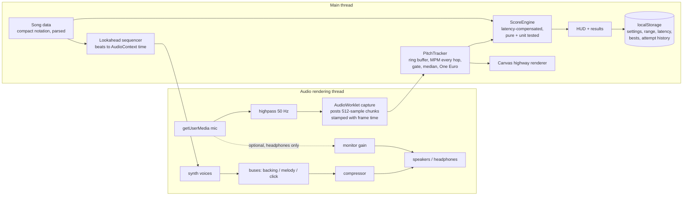

# Pitchline: browser singing game, design

Status: approved for build by the request itself (section 13: "briefly determine, then build").

## 1. Architecture

Static single-page app. Vite + TypeScript (strict), no UI framework, no backend. Everything runs locally in the browser; microphone audio never leaves the device.



Why this shape:
- Heavy DSP stays off the audio thread so the backing track can never glitch; the worklet only copies samples and stamps them with sample-accurate context time, so main-thread jank delays analysis but never misaligns it.
- All accompaniment is synthesized from note data, so tempo changes (75 %, 50 %) never alter pitch, and there is no licensing question about recordings.
- Pure modules (FFT, detector, tracker, scoring, transposition, song parser, onset detector, MIDI parser) have no DOM or Web Audio dependency and are covered by Vitest.

## 2. Pitch detection

McLeod Pitch Method (normalized square difference function), computed via FFT autocorrelation.
- Window 2048 samples (~43 ms at 48 kHz), hop 512 (~10.7 ms, ~94 estimates/s). Range 60 to 1500 Hz.
- Key-maximum picking with k = 0.9, parabolic interpolation; the NSDF peak value is the *clarity* used for voicing.
- Voiced only when RMS is above the sensitivity gate and clarity is at least 0.75. Unvoiced frames are never scored.
- Smoothing: 5-point median in cents (kills spikes and transient octave errors), then a One Euro filter for display (low jitter on held notes, low lag on note changes). Scoring uses the median output to avoid filter lag.
- Frames are stamped at the window center, in AudioContext time.

## 3. Song format

Authored as compact strings, parsed at load and validated by tests:

```
melody: "C4:1 C4 G4 G4 A4 A4 G4:2 | ..."   pitch:beats, duration sticky, R = rest, | = bar check
lyrics: "Twin kle twin kle lit tle star ..." one token per sung note, "~" = melisma continuation
chords: "C:2 F:2 C:2 ..."                    root+quality:beats
```

Parsed form: `{ midi, startBeat, beats, lyric }[]`, plus `bpm`, meter, tonic/mode, chords, named sections. Seconds are derived from beats and the current tempo factor.

## 4. Scoring

- Error per frame is the cents deviation from the target, folded to the nearest octave (octave forgiveness on by default, toggleable).
- Continuous frame accuracy `a(e) = exp(-(max(0, e - 8) / 45)^2)`: about 0.87 at 25 cents, 0.42 at 50 cents, 0.02 at 100 cents.
- Note value = 100 points per beat (speed-independent). Points accrue live per frame up to the note value, times the combo multiplier.
- Note judgment from the median absolute error of its voiced frames: Perfect <= 10 cents, Great <= 25, Good <= 50, else Off; Miss if under 30 % of the note was sung. The same bands color the live feedback (green / yellow / orange / red). (v1 used 15/30/50; v2 adopts the requested 10/25/50. Judging on the per-note median keeps vibrato and frame jitter from flickering the grade.)
- Combo: consecutive Good-or-better notes. Multiplier x1 / x1.5 / x2 / x3 at streak 0 / 4 / 8 / 16.
- Hold bonus: notes of 1.5 beats or more with at least 70 % of frames within the Great band (25 cents) earn +50 % of note value.
- Clean-entry bonus (smooth transitions): reaching within 50 cents of the new note within 120 ms of its start (and not judged Off) earns +20 %.
- Pitch accuracy % = beat-weighted mean of note accuracy. Timing accuracy % = mean onset score (1 at <= 100 ms, linear to 0 at 400 ms). Grade from pitch accuracy: S 93, A 85, B 75, C 60, D 45, else F.
- Timing forgiveness: a frame near a note boundary (within 100 ms) is matched against the neighbor note if it fits it better, so a late or early transition is not counted as wrong pitch.

## 5. Latency compensation

- Every voice frame is mapped to song time with `songTime = stamp - t0 - L`, where `L` is the round-trip latency (output + input).
- Default `L` before calibration: `outputLatency + baseLatency + track input latency` reported by the browser (fallback ~70 ms total).
- Calibration screen: a count-in plus 8 clicks; the player claps or says "ta" on each. An energy onset detector finds the first onset near each click; the median offset (with a spread check, at least 5 of 8 hits) becomes `L`. A manual slider remains in Settings.
- The visual playhead uses `getOutputTimestamp()` so it tracks what is actually being heard.

## 6. Screens

Home, Mic setup (permission, device, level meter, too-quiet / clipping warnings, headphones toggle), Range check (low note, high note, presets), Latency calibration, Song select (original key vs your key, bests, history), Play (highway, HUD, practice controls), Results (score, accuracy, timing, streak, struggled / nailed notes, per-section timeline, replay), Pitch Trainer (notes and intervals), Settings.

## 7. Out of scope for v1

Audio-file import (melody extraction from recordings is not reliable enough to be worth it yet). MIDI import is included as a secondary feature: monophonic melody from the busiest track, guide tone plus click, no chords.
